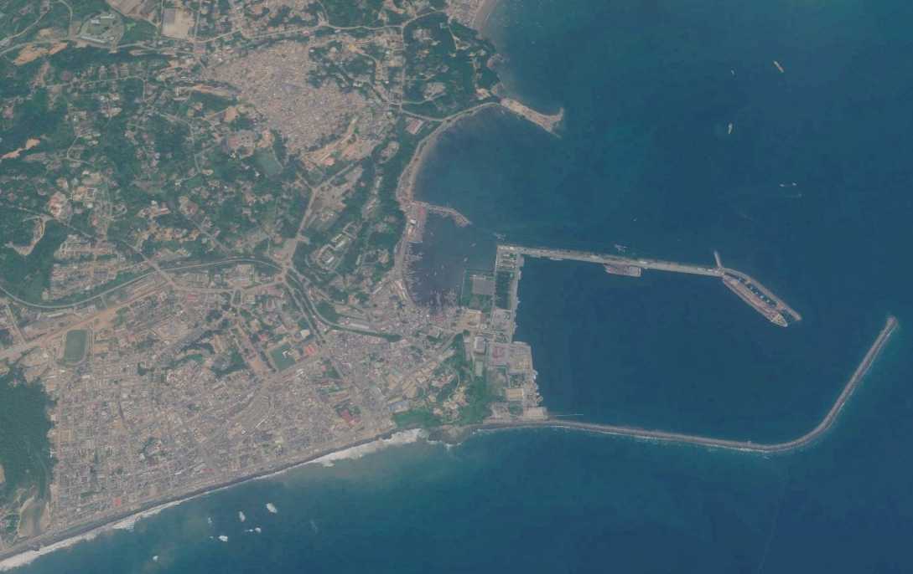
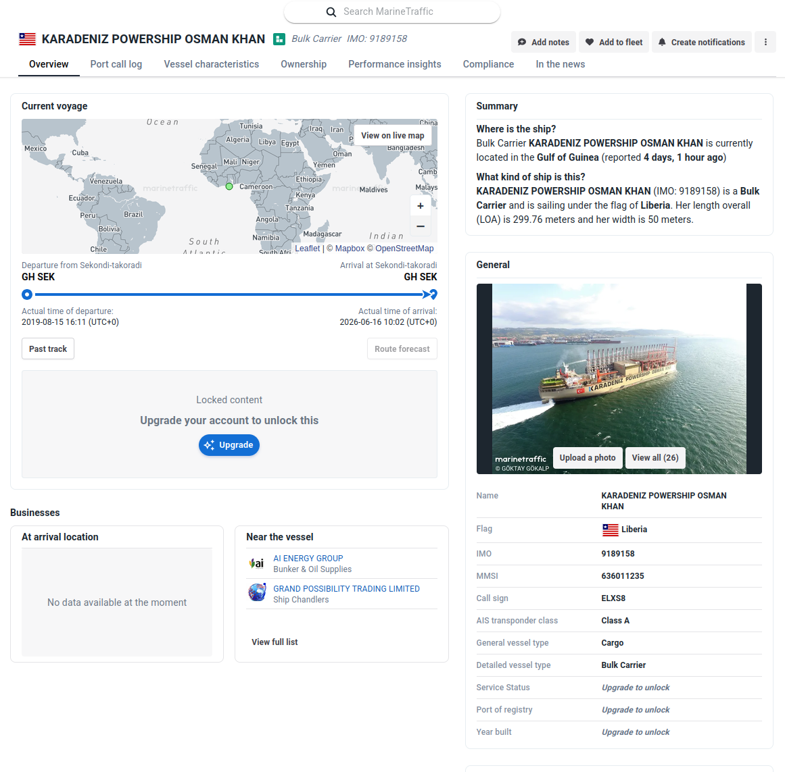

#  Maritime Origins

###### Querry: *"You see that ship there? The big one? That's been right there, somewhere on the world's second largest continent, for a long time. At least 5 years at this point. What is its IMO number?"*

## Solution

1. **Geographic Location:** The statement mentions the "*world's second largest continent*," which immediately leads us to **Africa**.
2. **Coastline & Port Details:** Looking at the satellite image, we see a distinct artificial harbor along a coastline running roughly southwest-to-northeast. Key visual markers include:
   - A long, curved southern breakwater extending out into the ocean.
   - A shorter northern pier/quay forming a protected basin.
   - A dense urban layout immediately adjacent to the port with green hills further inland.
   - By scanning major West and East African ports with similar breakwater geometries on Google Earth/Maps, the layout matches **Takoradi Harbour** in **Sekondi-Takoradi, Ghana**.
3. **Identifying the Vessel:** The prompt notes that this unusually large ship has been moored at this exact pier for "at least 5 years." Standard cargo vessels only stay in port for days or weeks, meaning this vessel had to be a permanent or semi-permanent fixture—such as a floating storage unit or a **powership** (floating power plant).
   - Searching for long-term moored vessels or powerships in Takoradi, Ghana reveals the ***Karadeniz Powership Osman Khan***, operated by Karpowership, which was deployed to Takoradi in August 2019 to supply electricity to Ghana's national grid.
4. **Finding IMO :** Looking up the *Karadeniz Powership Osman Khan* in  MarineTraffic gives its IMO.

- **Answer:** `9189158`

