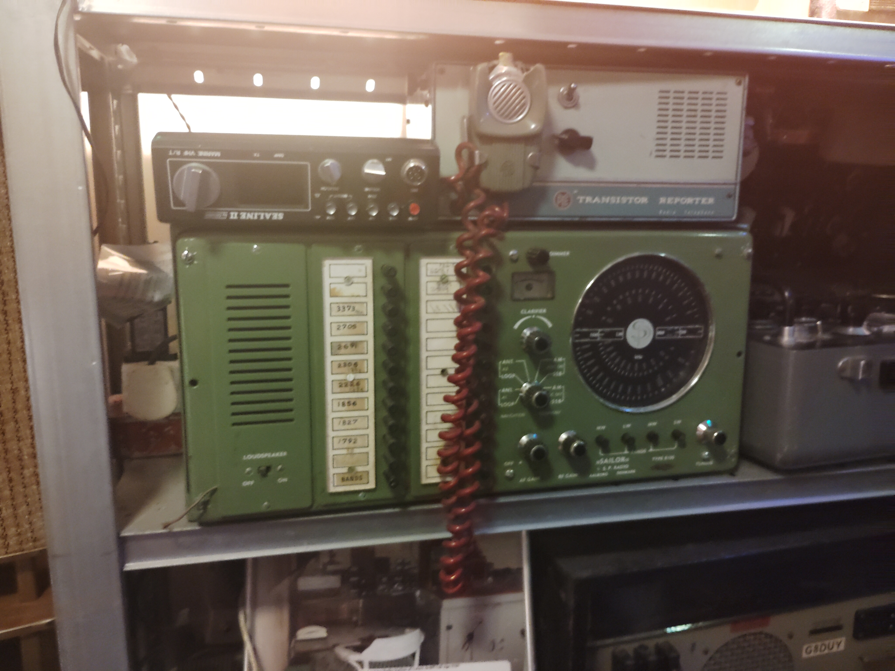
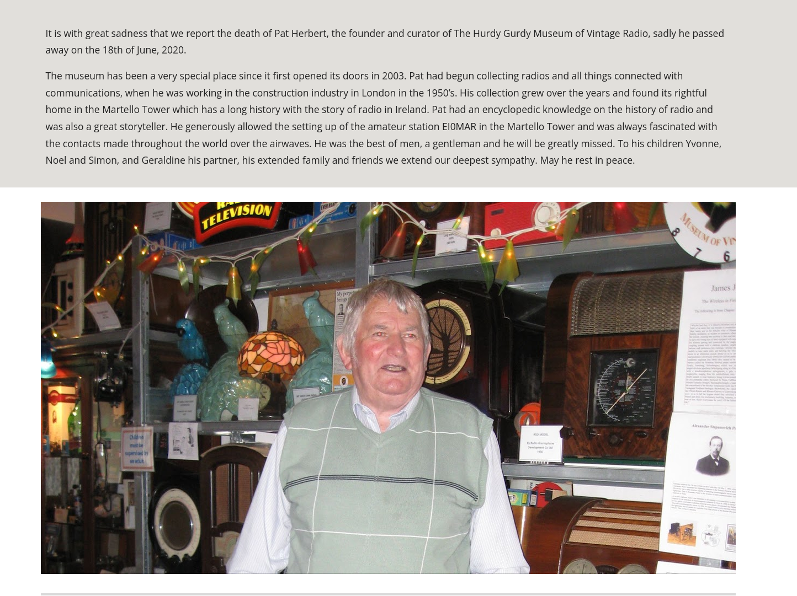

# This Is Wolv-01

###### **Statement:** *"A long time ago, the British Empire made a series of defensive forts, many of which still stand. In one of these towers, certain items are on display. What is the name of the man who founded and curated this? Flag format: wctf{FirstName_LastName}"*

## Solution

1. **Series of Defensive Forts:** During the 19th century at Napoleonic Wars, the British Empire built hundreds of small circular defensive coastal forts across Britain, Ireland, and its colonies, known as **Martello Towers**.
2. **Identifying the Equipment on Display:** Zooming in on the shelving unit in the photograph reveals several distinct pieces of vintage telecommunications and radio hardware:
   - **Top Left:** A *Sealine II* VHF marine transceiver.
   - **Top Right:** A *Pye Transistor Reporter* radiotelephone.
   - **Center:** A classic Danish-made **Sailor R105** marine radio receiver.
   - **Bottom Right:** Amateur radio equipment featuring a visible callsign tag reading **`G8DUY`**.
3. **Museum <-> Martello Tower:** vintage radio museums housed inside a "Martello Tower" leads  to **Ye Olde Hurdy Gurdy Museum of Vintage Radio**, located inside the historic Martello Tower in **Howth, County Dublin, Ireland**. 
4. **Founder and Curator:** Researching the history on the main page of Ye Olde Hurdy Gurdy Museum of Vintage Radio identifies its founder and longtime curator, **Patrick "Pat" Herbert**, who established the museum in the tower in 2003 using his personal collection and has passed away on the 18th of June 2020.

- **Flag:** `wctf{Pat_Herbert}`
