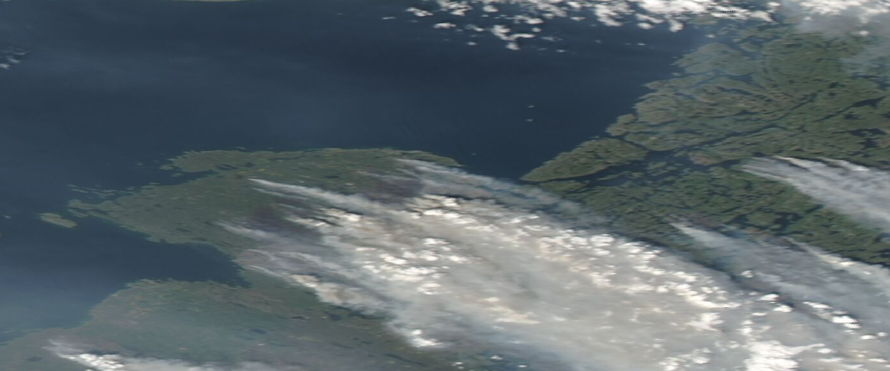
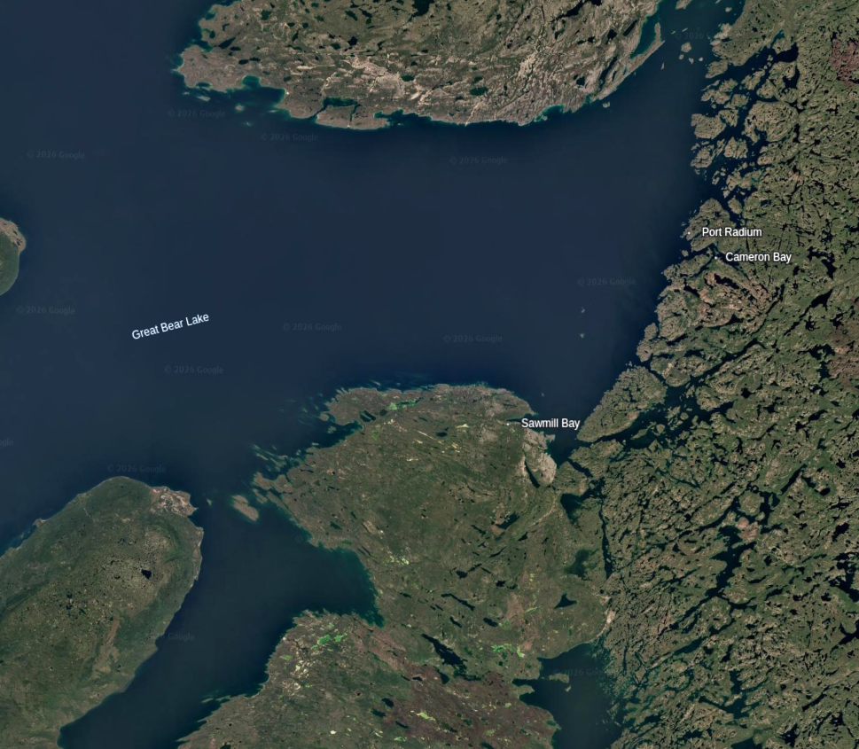

# Pants On Fire

###### **Statement:** *"I found this screenshot from sometime in the past year when clearing out my screenshots folder, any chance you can tell me the name of the body of water? P.S. Use all lowercase for the flag, and replace spaces with dashes."*

## Solution

1. **Satellite:** The image is low-resolution  satellite image (typical of NASA Worldview / MODIS sensors). The filename (`Pants_On_Fire.jpg`) and the **thick** white plumes blowing across the land indicate past or current **wildfires** and smoke.
2. **Geography:**
   - The terrain features dark, boreal-style forest and heavily glaciated, fractured bedrock/islands along the eastern shoreline (characteristic of the Canadian Shield).
   - To the west, two prominent peninsulas jut out into a massive body of fresh water, creating bays.
   - Comparing the shape of the central peninsula and the jagged eastern archipelago against large northern lakes in Canada (Great Slave Lake, Great Bear Lake, Lake Winnipeg, Lake Athabasca) reveals an exact match with **Great Bear Lake** in the **Northwest Territories, Canada**.
   - Specifically, the image shows the **Dease Arm** (top) and **McTavish Arm** (bottom-right), separated by the **Caribou Point / Leith Peninsula** region

- **Flag:** ~~`great-bear-lake`~~

